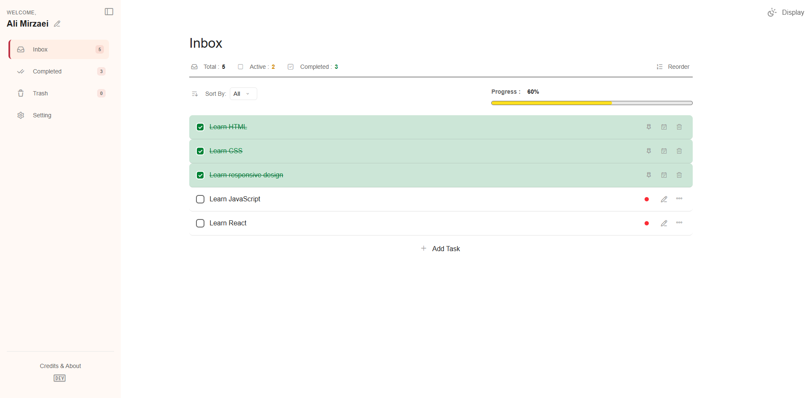
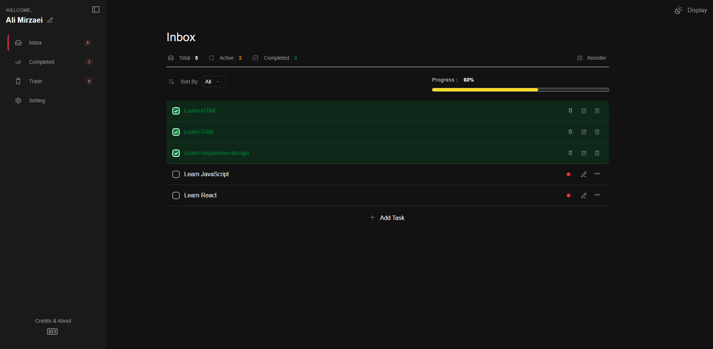
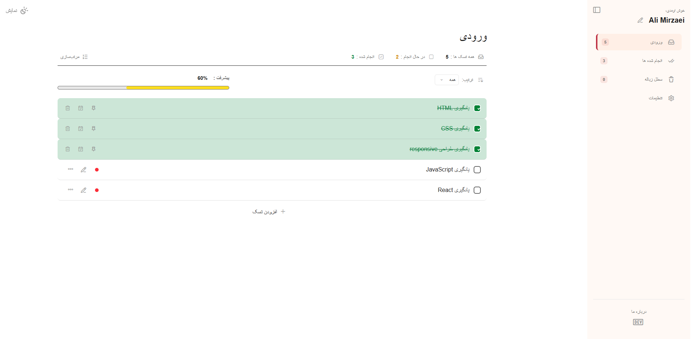

# JS-Todo-List | State-Driven Task Manager

A fully interactive, responsive To-Do List application built entirely with vanilla JavaScript. This project simulates a real-world productivity app (like Todoist or TickTick), featuring a custom state management system, LocalStorage persistence, nested dropdown menus, and a sleek UI with dark mode.

## Table of Contents
- [Demo](#demo)
- [Features](#features)
- [Screenshots](#screenshots)
- [Tech Stack](#tech-stack)
- [Project Structure](#project-structure)
- [Author](#author)

## Demo
[Live Demo](https://ali-mirzaei-dev.github.io/JS-Todo-List/)


## Features

- **State-Driven DOM | رابطه کاربری مبتنی بر وضعیت:**

  <p dir="rtl" align="right">
  رابط کاربری کاملاً از HTML جدا شده است. یک آرایه <code dir="ltr">tasks</code> به عنوان منبع حقیقت عمل کرده و تابع <code dir="ltr">renderTask()</code> با هر تغییر وضعیت، لیست را به صورت پویا بازسازی می‌کند.
  </p>

- **LocalStorage Persistence | ذخیره‌سازی در حافظه مرورگر:**

  <p dir="rtl" align="right">
  وظایف، زباله‌دان، تم کاربر و تنظیمات زبان در <code dir="ltr">LocalStorage</code> مرورگر ذخیره می‌شوند. برنامه پس از رفرش صفحه، وضعیت خود را بازسازی می‌کند.
  </p>

- **Nested Dropdown Menus | منوهای کشویی تودرتو:**

  <p dir="rtl" align="right">
  منوهای کشویی سفارشی و پویا با قابلیت بسته شدن هنگام کلیک در خارج از منو.
  </p>

- **Priority & Sorting System | سیستم اولویت‌بندی و مرتب‌سازی:**

  <p dir="rtl" align="right">
  امکان تعیین اولویت بالا، متوسط یا پایین برای وظایف، همراه با نشانگرهای رنگی و مرتب‌سازی بر اساس اولویت.
  </p>

- **Pin to Top | سنجاق کردن وظایف:**

  <p dir="rtl" align="right">
  امکان سنجاق کردن وظایف مهم به بالای لیست همراه با یک نشانگر اختصاصی.
  </p>

- **Archive/Trash System | سیستم زباله‌دان:**

  <p dir="rtl" align="right">
  وظایف حذف‌شده به زباله‌دان منتقل می‌شوند و امکان بازیابی یا حذف دائمی آن‌ها وجود دارد.
  </p>

- **Inline Editing | ویرایش درجا:**

  <p dir="rtl" align="right">
  امکان ویرایش مستقیم وظایف در محل نمایش آن‌ها، با جلوگیری از باز شدن هم‌زمان چند ورودی ویرایش.
  </p>

- **Custom Modals & Toasts | مودال‌ها و نوتیفیکیشن‌های سفارشی:**

  <p dir="rtl" align="right">
  چک‌باکس‌های سفارشی با CSS، پنجره‌های تأیید حذف و اعلان‌های بازخورد به کاربر.
  </p>

- **Dark Mode | حالت تاریک:**

  <p dir="rtl" align="right">
  قابلیت تغییر بین تم روشن و تاریک با استفاده از متغیرهای CSS و ذخیره تنظیمات در <code dir="ltr">LocalStorage</code>.
  </p>

- **Bilingual Support (EN/FA) | پشتیبانی دو زبانه:**

  <p dir="rtl" align="right">
  پشتیبانی از زبان‌های انگلیسی و فارسی با تغییر خودکار چیدمان بین راست‌به‌چپ (RTL) و چپ‌به‌راست (LTR).
  </p>

- **Responsive Design | طراحی واکنش‌گرا:**

  <p dir="rtl" align="right">
  نوار کناری کشویی که در موبایل به‌صورت پوششی تمام‌صفحه و در دسکتاپ به‌صورت یک ستون ثابت نمایش داده می‌شود.
  </p>


## Screenshots

<table>
  <tr>
    <td width="50%">
      
    </td>
    <td width="50%">
      
    </td>
  </tr>
  <tr>
    <td colspan="2">
      
    </td>
  </tr>
</table>

## Tech Stack

| Technology | Purpose |
|---|---|
| HTML 5 | Semantic markup & DOM structure |
| Tailwind CSS | Utility-first styling, responsive layout, and RTL support |
| JavaScript | State management, DOM manipulation, and event handling |

## Project Structure

```text

## Project Structure

```text
JS-Todo-List/
│
├── assets/
│   ├── Font/
│   ├── Images/
│   │ 
│   ├── JavaScript/
│   │   └── main.js
│   │ 
│   └── StyleSheet/
│       ├── master.css
│       └── output.css
│
└── index.html

```

## Author

**Ali Mirzaei** – Frontend Developer

- [GitHub](https://github.com/ali-mirzaei-dev)
- [LinkedIn](https://www.linkedin.com/in/ali-mirzaei-dev/)
- [Instagram](https://instagram.com/ali.mirzaei.dev)
- [ali.mirzaei.kt@gmail.com](mailto:ali.mirzaei.kt@gmail.com)